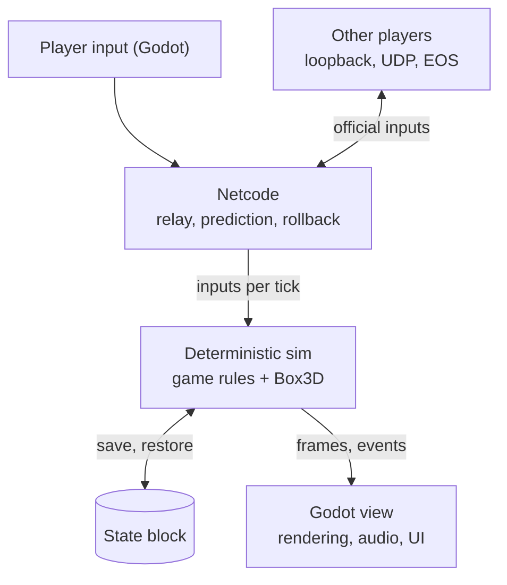

# unified

[](https://github.com/FylmTM/godot-unified/actions/workflows/ci.yml)

**A deterministic core for co-op games with rollback netcode, written in Odin, with Godot as the host.**

`unified` runs a game's simulation as a fixed-tick, bit-for-bit deterministic function of player input, and
[Godot](https://godotengine.org) (through GDExtension) renders it, plays its audio and draws its UI. Rigid-body
physics ([Box3D](https://github.com/erincatto/box3d)) runs inside the rollback. Everything is code-first and driven
from one CLI. It's built for fast iteration and for AI coding agents.

> [!NOTE]
> **Status: pre-1.0.** The API is not stable yet, and breaking changes land without notice.

## Features

- **Deterministic simulation:** f32 math with a strict discipline (no FMA, no platform transcendentals) that gives
  the same bits on x64 and ARM64, so macOS, Windows and Linux players can play together.
- **One pointer-free state block:** a snapshot is a memcpy, a checksum is a hash of the bytes, and a late joiner
  receives the block.
- **Physics inside rollback:** Box3D through [unified-box3d](https://github.com/FylmTM/unified-box3d), an Odin port
  that saves, restores and hashes the world.
- **Input-relay netcode:** the host stamps each tick's official inputs, so one laggy player never stalls the others.
  Each client predicts and rolls back, and players can join late or rejoin after a drop. It needs no backend.
- **Pluggable transports:** in-process loopback, direct UDP / LAN, and Epic Online Services (lobbies by code, P2P
  with relay fallback).
- **Sync-test mode:** the headless `synctest` mode, and a scenario every game's test suite runs, roll back and
  re-simulate on every tick and compare checksums with the forward run, so state that would diverge online fails
  offline. (Single player is a host with no remote links: nothing rolls back there.)
- **Replays and reference runs:** replays are exact regression tests within a build, and every platform has to reproduce the
  recorded reference runs bit for bit.
- **Headless everything:** N clients in one process with a network simulator, for tests, CI and agents.
- **Godot host:** the view reads predicted frames for motion, verified frames for scores and events for effects.
  It never writes to the simulation. Dev tools live in the game.

## How it works



All simulation state lives in one contiguous block with no pointers (handles instead). Physics state lives in Box3D
and is saved, restored and hashed alongside the block. Player input is the only way into the simulation: the view
only reads it. That single rule makes snapshots, rewind, late join and sync-test cheap, and it lets the
"single player ⇒ online" property be checked rather than hoped for.

A game is a deterministic sim package (its state, input and tick) plus a Godot project. The library supplies the
harness, physics, netcode, the headless runs and the Godot host. [`src/README.md`](src/README.md) explains how the
core works inside.

## Why

- **No glue between two worlds.** When an engine owns the scene and a separate deterministic sim owns the game,
  the two are joined by bridges, schema codegen, map baking, asset exports and a second physics world. Here the sim
  is the game, and Godot only views it.
- **Code-first, not editor-first.** Levels and content come from code and scripts, everything runs from the CLI,
  and dev tools live inside the game.
- **Fast loops.** Builds, tests and tools are held to time budgets. Co-op is tested headless, many clients per
  process, without making a build.
- **Agent-friendly.** One CLI with self-describing commands, deterministic tests and parallel worktrees: AI agents
  can do most of the work safely.

## Design targets

- **Platforms:** Steam on Windows x64, macOS ARM64 and Linux / Steam Deck. Consoles are out of scope for now.
- **Crossplay** between macOS ARM64 and Windows x64, so determinism holds bit for bit across architectures.
- **Scale:** 2–4 players, a per-game tick rate (a power of two, 64 Hz by default), 1000+ entities and full rigid-body
  physics inside rollback.
- **Simulation:** single-threaded f32 (fixed point was rejected). Parallel only where measurements demand it.
- **Testing:** headless sim tests, per-game end-to-end suites, and reference runs that CI reproduces on Linux x64
  and arm64, Windows x64 and macOS ARM64.
- **Gameplay code:** plain functions over typed queries, with minimal magic.
- **Minimal dependencies:** every third-party dependency needs a reason and its own tests.

## The games

Four co-op games in this repo prove the library. Each is a Godot project with its Odin sim in `simulation/`.

- [`games/minimal_3d/`](games/minimal_3d/SPEC.md): the smallest 3D game (capsules that throw balls), the showcase
  of how to write a game and the base of `uni init`'s template.
- [`games/survivor/`](games/survivor/SPEC.md): a top-down survivor with waves of enemies and physics props (3D).
- [`games/friendslop/`](games/friendslop/SPEC.md): a third-person physics sandbox: carry, stack, throw (3D).
- [`games/drift/`](games/drift/SPEC.md): a ship arena defending a station (2D views, physics locked to a plane).

## Getting started

Toolchain (macOS ARM64, Linux x64 or Windows x64):

- **Odin** at the release and commit `pins.cfg` pins: nothing to install. The first `./uni` uses the odin on PATH
  when it is that one, else downloads that release once (SHA-256 checked) into a per-user cache
  (`~/.cache/unified/odin`, Windows `%LOCALAPPDATA%\unified\odin`). The pinned Godot goes there too
  (`unified/godot`), once for every checkout.
- What Odin needs anyway: **clang** on macOS and Linux; on Windows, Visual Studio Build Tools (its linker and the
  Windows SDK). Nothing in the repo is C or C++.
- **git** and **curl** (macOS, Windows 10+ and Linux ship curl).
- **Editor:** VS Code with the OLS extension picks up `ols.json` (the `unified` and `box3d` collections, the strict
  checker flags, format on save with `odinfmt.json`).

The CLI fetches or builds everything else (Godot, odinfmt, Box3D) from `pins.cfg`. A local Godot or unified-box3d
checkout can stand in through `UNIFIED_GODOT` and `UNIFIED_BOX3D` in a git-ignored `.env`. Online play also needs the
EOS SDK, which Epic's licence keeps out of the repo: download it and set `UNIFIED_EOS_SDK` and the `UNIFIED_EOS_*`
IDs ([`docs/EOS.md`](docs/EOS.md)). Everything else works without it. All settings: [`src/cli/SPEC.md`](src/cli/SPEC.md).

Then, from the repo root (`uni.cmd` on Windows):

```sh
./uni help                # every command (the first run builds the CLI)
./uni test                # build and run every test package
./uni run survivor        # play it (builds its extension the first time)
./uni verify              # everything CI runs
./uni init ../mygame      # a new game repo, with unified as its submodule
./uni init games/mygame --in-repo # a new game inside this repo
```

## Documentation

- `SPEC.md` next to each module (`src/<pkg>/SPEC.md`) and game (`games/<game>/SPEC.md`): what it does and how.
- [`src/README.md`](src/README.md): how the core works inside, across packages.
- [`tools/main.odin`](tools/main.odin): this repo's CLI, `uni`, and its private commands.
- [`AGENTS.md`](AGENTS.md): the rules and workflow for working on unified, for people and agents alike.
- [`docs/EOS.md`](docs/EOS.md): online setup.
- [Issues](https://github.com/FylmTM/godot-unified/issues): current and upcoming work.

## License

Licensed under either of [Apache License 2.0](LICENSE-APACHE) or [MIT license](LICENSE-MIT), at your option.

Unless you explicitly state otherwise, any contribution intentionally submitted for inclusion in the work by you, as
defined in the Apache-2.0 license, shall be dual licensed as above, without any additional terms or conditions.

Third-party code keeps its own license: Box3D and unified-box3d (MIT), Godot (MIT). The EOS SDK is not included.
